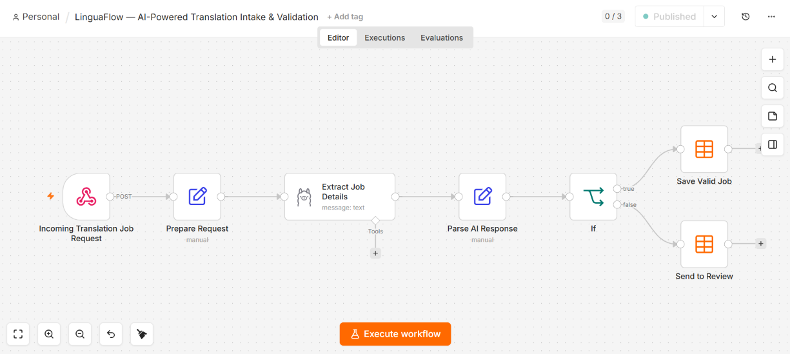

# LinguaFlow — AI-Assisted Translation Request Intake & Validation

## Project Overview

LinguaFlow is a prototype workflow automation system designed to streamline the intake and validation of translation requests for a fictional language services company.

The workflow uses a locally hosted large language model (LLM) to extract structured information from incoming requests, applies validation rules to identify missing information, and routes requests to the appropriate data table for processing or manual review.

The project demonstrates how AI and workflow automation can reduce repetitive administrative work while keeping incomplete or ambiguous requests visible for human review.

## Workflow Overview



The workflow follows these steps:

1. **Receive request:** Accepts an incoming translation request through an n8n webhook.
2. **Prepare request:** Combines the subject and body into a single text input and preserves the sender's email address.
3. **Extract job details:** Uses a locally hosted LLM through Ollama to extract structured information from the request.
4. **Parse AI response:** Converts the model's JSON response into structured fields.
5. **Validate request:** Checks whether required information is present, including the service type and source language. Translation requests must also include a target language.
6. **Route request:** Saves valid requests to the main data table and routes incomplete requests to a review table.

## Technology Stack

- **n8n:** Workflow automation and orchestration
- **Ollama:** Local LLM execution
- **Llama 3.1 8B:** Information extraction from incoming requests
- **n8n Data Tables:** Storage of accepted requests and requests requiring review
- **Webhook:** Entry point for incoming requests

## Current Capabilities

- Extracts structured information from unstructured request text.
- Captures service type, source and target languages, deadlines, urgency, quote requests, reference numbers, and additional details.
- Preserves the original request text for traceability.
- Applies validation rules before routing requests.
- Separates accepted requests from requests requiring manual review.
- Uses a locally hosted LLM rather than sending request text to a hosted LLM API.

## Known Limitations

- The LLM may incorrectly infer a service type when the request is ambiguous.
- The validation rules depend on the accuracy of the information extracted by the model.
- Deadline parsing and timezone handling require further validation.
- Requests routed for review currently receive a general review reason rather than a detailed explanation of every missing field.
- The workflow is a prototype and has not been established as a production-ready system.

## Project Status

The initial prototype is implemented, with the core intake, extraction, validation, and routing workflow in place.

Two end-to-end test scenarios have been completed successfully:

- A complete translation request was extracted and saved to the valid jobs table.
- A translation request missing its target language was routed to the manual-review table rather than the valid jobs table.

Further work will focus on expanding test coverage, improving reproducibility, and evaluating the reliability of AI-based extraction and validation.

## Testing

The repository includes sample JSON payloads and documentation for reproducing the two completed test scenarios.

**Test cases:**

1. **Valid translation request:** Verifies that a complete English-to-Canadian-French request is extracted and saved to the valid jobs table.
2. **Missing target language:** Verifies that a translation request without a target language is routed to manual review.

Test resources:

- [Sample test payloads](tests/payloads/)
- [Test instructions and scenarios](tests/README.md)
- [Expected results and verification](tests/expected-results.md)

Both scenarios have been executed successfully using the current workflow configuration. See the test documentation for the payloads, expected results, and verification details.

## Privacy and Security

The project uses a fictional company name and is intended as a portfolio demonstration.

The workflow is designed around local LLM execution through Ollama. However, local inference alone does not guarantee complete data privacy or security; deployment configuration, access controls, logging, and data storage must also be considered.

Before reusing or deploying the workflow, configure the required n8n credentials, data tables, and local Ollama connection. Review all configuration and sample data before using the workflow with real client information.

## Setup and Configuration

### Prerequisites

Before running LinguaFlow, ensure you have the following installed and running:

- **Docker Desktop** — runs the n8n container.
- **n8n** — the workflow automation platform.
- **Ollama** — runs the local language model.
- **Llama 3.1 8B** — the model used for extracting structured information from requests.

### Model Configuration

LinguaFlow uses the `llama3.1:8b` model through Ollama. Ensure the model is available locally before running the workflow.

To check that the model is available, run this command in a terminal:

```bash
ollama list
```

If the model is not listed, download it using:

```bash
ollama pull llama3.1:8b
```

### Ollama Connection Configuration

Users must provide their own running Ollama instance and configure an appropriate Ollama credential in n8n.

The workflow's Ollama connection must point to an address accessible from the n8n environment. For example, when n8n runs in Docker Desktop and Ollama runs directly on the host machine, the connection address is typically:

`http://host.docker.internal:11434`

The exact connection address depends on the user's deployment environment.

Once the connection is configured, select the corresponding credential and the `llama3.1:8b` model in the AI extraction node.

Ollama installation, model hosting, and environment-specific networking configuration are the user's responsibility and are outside the scope of this workflow demonstration.

### Importing the Workflow

1. Open your n8n instance.
2. Open the workflow menu and select **Import from File**.
3. Select `linguaflow-request-intake-validation.json` from the project repository.
4. Configure the Ollama credentials and select the appropriate data tables.
5. Save the workflow.

**Note:** The imported workflow requires configuration before it can run. Verify the credential settings and data table references in your n8n instance.

### Running a Test

1. Start n8n and Ollama.
2. Open the imported LinguaFlow workflow.
3. Use the webhook test listener or activate the workflow, as appropriate.
4. Send one of the sample JSON payloads using Postman.
5. Inspect the n8n execution to confirm which route the request followed.
6. Check the corresponding data table:
   - `LinguaFlowJobs` for valid requests.
   - `LinguaFlowReview` for requests requiring manual review.

The current webhook expects a flat JSON payload containing `subject`, `sender_email`, and `message`.

Use fictional request data when testing. For detailed instructions and expected outcomes, see the [test documentation](tests/README.md).